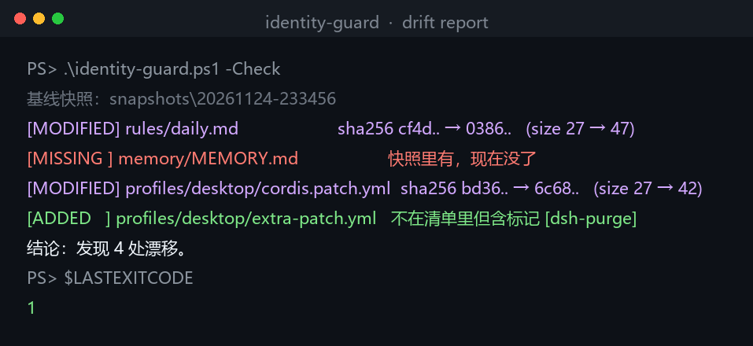

# identity-guard

> **agent 是由一堆配置文件定义出来的。这堆文件被谁改了，它会告诉你。**



宿主更新、插件被覆盖、规则被误改——这些都发生在你不在场的时候，而且**不会报错**。等到某天 agent 行为变了，你才发现自己的提示词、规则、profile 补丁已经不是原来那份了。

`identity-guard` 给这组文件打 SHA256 快照，之后一条命令告诉你：**哪些被改了、哪些没了、哪些是清单外新增的**。还能把改坏的现场备份下来再一键还原。

纯 PowerShell 5.1+，零依赖，零服务，零数据库。

## 输出长什么样

一致时：

```text
基线快照：snapshots\20261124-233456
[OK      ] 9 个核心文件一致，29 个扩展文件一致
```

有漂移时（上面那张图，真实运行输出）：

```text
基线快照：snapshots\20261124-233456
[MODIFIED] rules/daily.md                     sha256 cf4d.. → 0386..   (size 27 → 47)
[MISSING ] memory/MEMORY.md                   快照里有，现在没了
[MODIFIED] profiles/desktop/cordis.patch.yml  sha256 bd36.. → 6c68..   (size 27 → 42)
[ADDED   ] profiles/desktop/extra-patch.yml   不在清单里但含标记 [dsh-purge]
结论：发现 4 处漂移。
```

三种标记分别对应三种事故：**被改了内容**、**被删了**、**被塞进来一个不该有的**。最后这条最难自己发现——插件覆盖别人的文件时，从来不走你。

## 快速开始

```powershell
git clone <this-repo> C:\identity-guard
cd C:\identity-guard

# 1. 复制示例配置（真实配置已进 .gitignore）
Copy-Item .\identity.config.example.json .\identity.config.json

# 2. 编辑 identity.config.json：填 root、coreFiles、watchPatterns

# 3. 建立基线
powershell -NoProfile -ExecutionPolicy Bypass -File .\identity-guard.ps1 -Snapshot

# 4. 随时自检（默认动作，不带参数就是 -Check）
powershell -NoProfile -ExecutionPolicy Bypass -File .\identity-guard.ps1

# 5. 看快照列表 / 还原
powershell -NoProfile -ExecutionPolicy Bypass -File .\identity-guard.ps1 -List
powershell -NoProfile -ExecutionPolicy Bypass -File .\identity-guard.ps1 -Restore
powershell -NoProfile -ExecutionPolicy Bypass -File .\identity-guard.ps1 -Restore -From 20261124-233456

# 6. 每日巡检（默认任务名 AgentIdentityCheck，每天 22:30 + 登录后 5 分钟补跑）
powershell -NoProfile -ExecutionPolicy Bypass -File .\install-task.ps1 -Mode on
```

## 配置

| 字段 | 类型 | 说明 |
|---|---|---|
| `root` | string | 被守护的 agent 配置根目录 |
| `snapshotDir` | string | 快照目录（相对或绝对） |
| `coreFiles` | string[] | 核心文件相对路径，逐字节 SHA256 比对 |
| `watchPatterns` | object[] | 扩展监控：`{ "glob": "profiles/**/*.yml", "contains": "[dsh-purge]" }`。`contains` 留空表示只要 glob 命中就算 |
| `excludeDirs` | string[] | 扫描时整棵剪掉的目录名。默认 `node_modules` `.git` `cache` `storages` `sessions` `logs` `snapshots` `attachments` |
| `maxScanFiles` | int | 扫描上限，默认 20000。到顶会打 Warning，不静默漏检 |
| `hostMeta` | object | 可选：宿主版本与模型信息路径，读不到写 `未知`，不报错 |
| `retainSnapshots` | int | 快照保留份数，超出删最旧的 |

## 退出码

| 码 | 含义 |
|---:|---|
| `0` | 一致（或快照/列表/还原后自检通过） |
| `1` | 检测到漂移，同时写 `ALERT.txt` |
| `2` | 配置或环境错误（配置不存在、JSON 非法、`root` 不存在、无可用快照） |

退出码是给定时任务用的：`0` 静默，`1` 通知，`2` 修配置。

## 两个必须知道的坑

1. **`excludeDirs` 默认会漏掉装在被排除目录里的插件文件。** 实测某机器上含目标标记的文件共 3 个，其中 2 个在 `node_modules` 下。要监控真正生效的那份，就把 `watchPatterns` 指到实际加载路径，或把该目录从 `excludeDirs` 里去掉（代价是变慢）。
2. **隐藏目录要算进去。** `Get-ChildItem` 不加 `-Force` 会跳过 `.config` / `.browser-source` 这类目录；本工具用 .NET 的 `GetDirectories()`，默认**包含**隐藏目录。所以它的命中数会比手工 `ls` 出来的多——工具是对的。

## 性能

在 49,804 个文件 / 3.4 GB 的真实配置根目录上实测：

| 场景 | 耗时 |
|---|---|
| 带 `excludeDirs` 剪枝（默认） | **3.7 秒** |
| 不剪枝（旧实现，`Get-ChildItem -Recurse` 全扫） | **> 120 秒** |

实现上是显式栈遍历 + 整棵子树剪枝，不是"扫完再过滤"。

## 它不管什么

- 不管文件**内容**对不对，只管"和快照是不是同一份"
- 不做版本管理（那是 git 的事），只做"现在 vs 基线"
- 不监控进程、不监控网络、不做完整性签名

## 自测

```powershell
powershell -NoProfile -ExecutionPolicy Bypass -File .\tests\selftest.ps1
```

28 项断言，零依赖，在 `$env:TEMP` 里造假环境跑完整链路：快照 → 改一个字节 → 删文件 → 加带标记的新文件 → 还原 → 还原后自检 → 配置写坏 → 快照保留策略 → `-Quiet`。

## License

MIT
